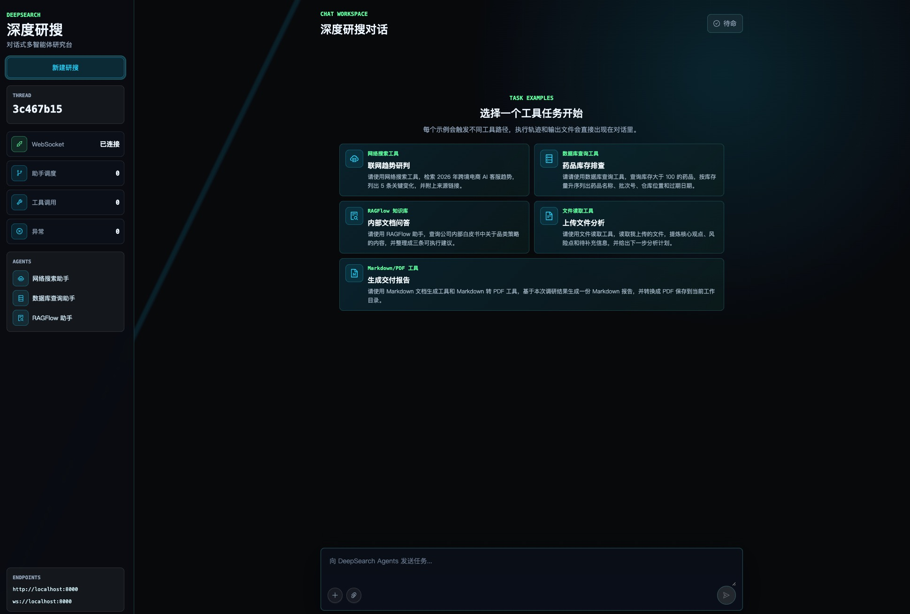

# 深度研搜 · 多智能体深度研究系统

**一个开放问题 → 主智能体拆解方向 → 三路子智能体并行查证 → 带出处的报告。** 行业调研、竞品分析、技术选型这类没有固定路线的任务，系统边走边定：查什么来源、查几轮、查多深，由主智能体根据中间结果动态调度。

**我的角色**：0→1 产品经理，负责 PRD（V1→V3 三轮迭代）、主/子智能体行为合同、评测标准与 judge 机制、成本测算与灰度方案。

## 用一次是什么体验

- 提交任务后执行计划实时可见：拆了哪几个方向、每个方向派给哪个来源、进行到哪一步
- 报告每条事实结论挂来源 id，能沿"报告 → 子结论 → 原始来源"追到出处，可复核
- 查不到的信息明确列进"未能获取"清单，不编造
- 系统额外接入企业数据库与内部知识库——通用深度研究产品（Deep Research、Kimi 探索版）验证了需求，但边界停在企业数据之外

## 产品设计上我定了几件关键的事

**1. 用多智能体分工，把"想"和"查"分开**
主智能体只调度与成文、不亲自检索；网搜、查库、知识库各配一个子智能体，独立上下文执行、只回传结论摘要——原始长文不进主上下文，避免长任务里上下文互相污染。同时也明确写了**什么时候不该拆**：一步能完成的小任务、强耦合子任务，拆开反而费钱丢上下文。

**2. 每个子智能体有行为合同**
- 网搜助手：单题至少 3 个检索角度、最多 5 次，只回传要点+来源，不回传原始长文
- 数据库助手：先列表确认表名再写 SQL，禁止猜表名；失败必须带真实错误
- 知识库助手：无匹配时明说查不到，不强行作答

**3. 充分性检查 + 缺口披露**
信息不够先补搜（上限 3 轮），仍不够就输出"以下信息未能获取"+已有结论，正常收尾。报告置信度分三档：可直接交付 / 带保留交付 / 暂缓交付。

**4. 一票否决只收"诚信类"**
编造结论、工具失败谎报、白名单外工具调用——出现一次即验收不通过。可用性问题归完成率兜底，不让基础设施抖动一票否决验收。judge 只做初筛，编造类以人工为金标；judge 不能与被测模型同家族。

**5. 指标冲突时让步顺序写死**
9 个指标会互相拉扯（查得全就慢），真冲突时按顺序让：底线（不编造/不谎报/不越权）永远不让 → 质量 → 可用 → 效率最先让。

## 实测基线

| 项 | 数值 | 说明 |
|---|---|---|
| 单路基线（Dify MVP 实测） | 41.2s / 85,113 tokens / ≈¥0.14 | 唯一实测锚点，用于校准观察线，不作线性外推 |
| 任务时长观察线 / 目标线 | ≤180s / ≤60s | 以真实任务实测分布校准 |
| 单任务 token 观测线 / 熔断上限 | 250k / 300k | 超熔断强制收尾，不编造 |
| 一票否决项 | 编造 =0、谎报 =0、越权 =0 | 触发即回滚 |

> 其余指标为验收基线（观察线/目标线），标注于 PRD 效果定义章节，非实测结果。

## 与电商问数系统的差异

两个系统都是"自然语言 → 数据"，但形态不同：问数系统是**固定流程编排**（LangGraph 12 节点，路径可穷举），本系统是**自由决策 Agent**（主智能体动态调度，路径不可穷举）。因此评测方式不同——问数系统靠结果比对判分，本系统需要 judge 评估 + 人工抽检 + 轨迹评估（派单合理性、补搜不空转）。

---

详细设计（行为合同全文、Eval Spec 与 judge 配置、能力边界、成本降级链、灰度与回滚）见 **[深度搜索系统-PRD.pdf](./深度搜索系统-PRD.pdf)**。

| 深入阅读 | 内容 |
|---|---|
| [deepsearch-agents/](./deepsearch-agents/) | 源码：主智能体 + 三路子智能体 + WebSocket 事件流 + FastAPI |
| [示例产出/](./示例产出/) | 系统真实生成的两份报告（网搜路：创新药出海交易研究；数据库路：药品库存分析） |
| [deepsearch-agents/docs/images/](./deepsearch-agents/docs/images/) | 系统架构图与交互截图 |

> 技术栈：Python + DeepAgents + FastAPI + WebSocket ｜ Tavily（网搜）+ MySQL（企业库）+ RAGFlow（知识库）

---

**贡献边界声明**：本系统技术实现基于开源教程 [ai-agents-from-zero](https://github.com/didilili/ai-agents-from-zero) 的实战项目配套源码（deepsearch-agents）。我的贡献在产品侧：完整 PRD（背景、行为合同、评测标准、能力边界、成本预算、灰度与回滚）、差距清单（prd-gap.md，未实现能力如实挂账）与评测体系设计。技术实现部分用于支撑产品设计的可行性与验收。
