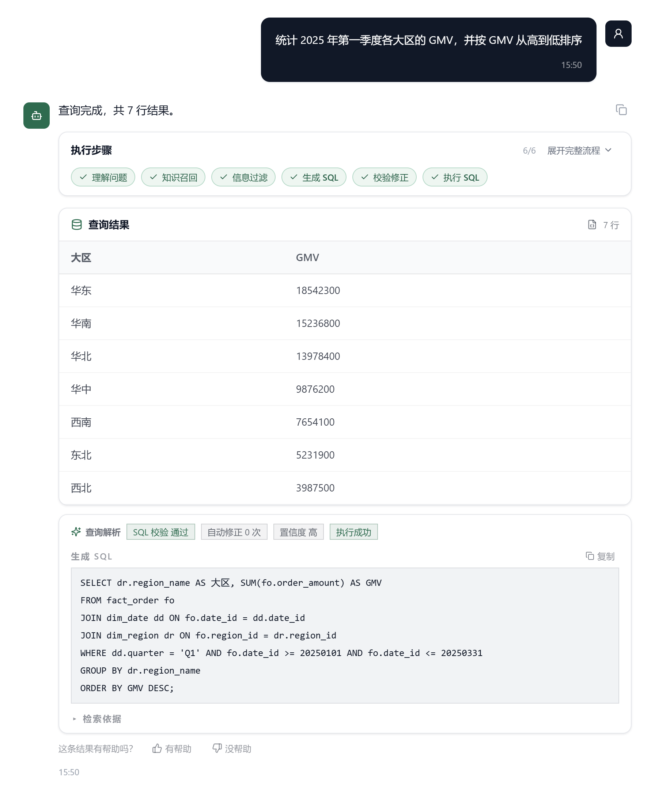
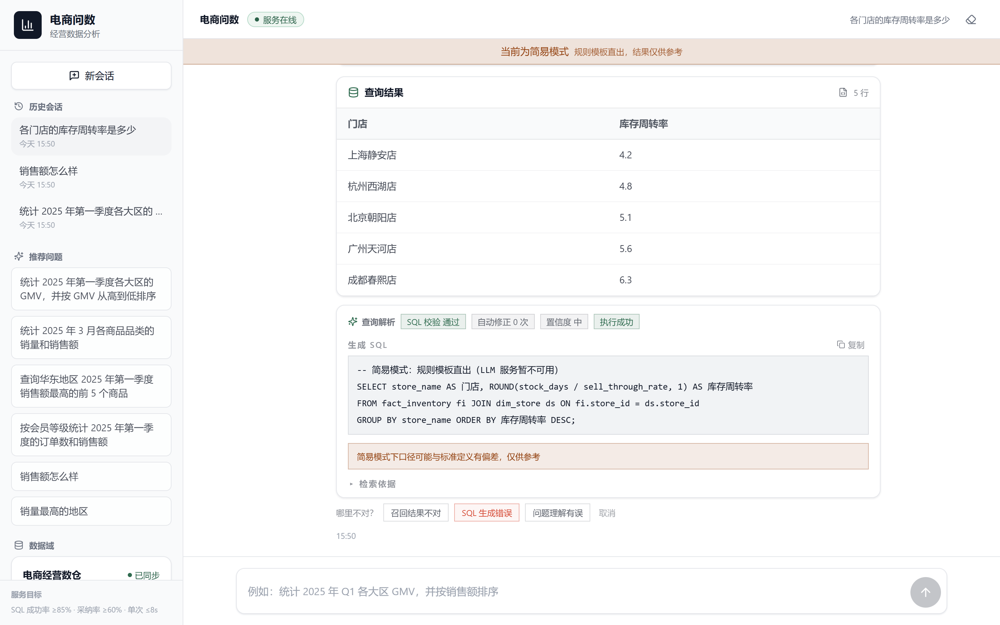
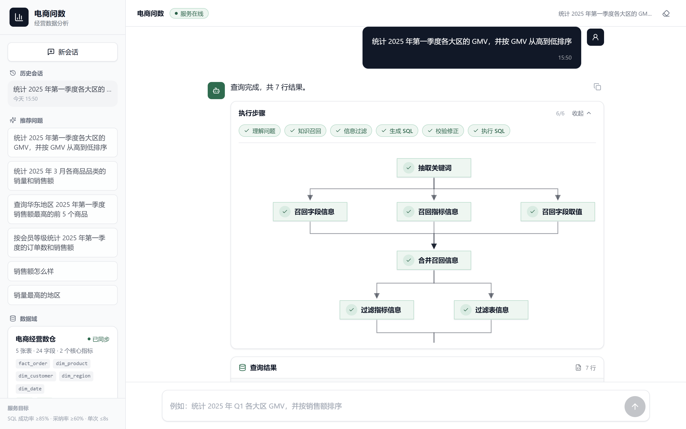

# 问数系统 · 电商自然语言问数（NL2SQL）

业务同学用中文提问，系统自动生成 SQL、返回真实数据——不用等数据同学排期取数。

这是一个 0→1 的 AI 产品项目，我担任产品经理：写 PRD、定验收标准、设计边界与降级方案，并推动开发落地。

---

## 一、这个产品最怕什么？

**错答比报错危险。** 报错用户知道要重问；错答会让业务拿着假数据做决策，还不自知。

错误有三种来源，系统必须各有一条防线：

| 错误来源 | 例子 | 防线 |
|---|---|---|
| 问题模糊 | "上周销量怎么样"——哪个平台？含不含退款？ | 不猜，主动澄清 |
| 超出范围 | "帮我查用户手机号" | 明确拒答，不越权 |
| SQL 写错 | 指标口径错、表 join 错 | 生成 SQL 必须带证据约束，再校验修正 |

---

## 二、我的三个核心设计

### 1. 系统只会说三种话：回答、澄清、拒答

写进 Prompt 行为合同，从源头杜绝"硬凑一个看起来对的答案"。

模糊问题不硬猜，明确要求补齐时间范围和口径：

### 2. 每个答案都可查证

结果卡不只给数字，SQL、命中字段、置信度全部展开——业务能看懂数据怎么来的，怀疑可以当场验证：

### 3. 错题有人管：点踩必须归因

用户点踩必须选原因（口径错 / 数据错 / 表述错），归因结果回流 badcase 库，进评测集，下一轮修复有据可依：

---

## 三、结果

- 建立 **100 条三层评测集**（模糊/越权/常规）作为上线门禁
- SQL 正确率首跑 **57%**，复盘修复后 **97%**，越权查询 **0**
- 换模型决策（MiMo vs DeepSeek）做准确率 / 延迟 / 成本三维对照，单次查询成本压至 **¥0.0024**

完整执行过程可观察——每一步检索、生成、校验都能展开看：

---

## 四、更多材料

| 内容 | 位置 |
|---|---|
| 完整 PRD（需求、验收标准、边界、上线设计） | [问数系统-PRD.pdf](./问数系统-PRD.pdf) |
| 知识库三库元数据（表字段 / 指标 / 真实取值） | [dify/](./dify/) |
| 源码（LangGraph 12 节点编排） | [shopkeeper-agent/](./shopkeeper-agent/) |
| 全部交互截图 | [原型截图/](./原型截图/) |

> 技术栈：Python + FastAPI + LangGraph ｜ MySQL + Qdrant + Elasticsearch（IK）+ bge-large-zh ｜ React + Vite
