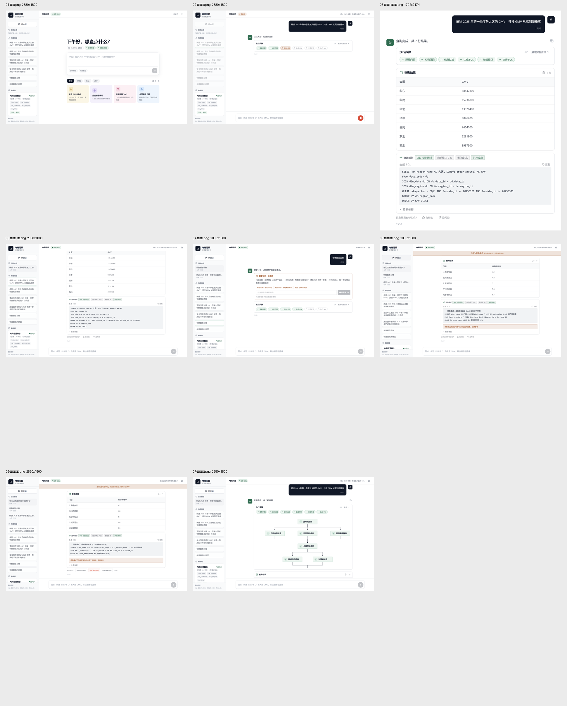

# 问数系统 · 电商自然语言问数（NL2SQL）

> 业务人员用中文提问，系统自动生成 SQL，返回真实数据。**错答比报错危险**——模糊问题走澄清，超范围问题走拒答，而不是硬凑一个看起来对的答案。



## 核心链路（LangGraph 编排）

```text
中文提问
  → 关键词抽取与多路召回：字段 / 指标 / 字段真实取值（三路并行）
  → 过滤与补全：filter_table / filter_metric
  → 召回信息合并
  → SQL 生成（带证据约束，非自由生成）
  → SQL 校验 → 修正 → 执行
  → 结果卡：数据 + SQL + 命中字段 + 置信度全部展开
```

对应代码：`shopkeeper-agent/app/agent/nodes/`（recall_column / recall_metric / recall_value / filter_table / filter_metric / merge_retrieved_info / generate_sql / validate_sql / correct_sql / run_sql / add_extra_context）。

## 产品机制与代码证据

| 产品机制 | 解决的问题 | 代码位置 |
|---|---|---|
| Prompt 行为合同：生成 / 澄清 / 拒答三形态 | 模糊问题硬凑口径、超范围越权取数 | `prompts/`、`app/agent/nodes/generate_sql.py` |
| SQL 安全白名单 | 越权查询、危险语句 | `app/core/sql_safety.py` |
| 三库元数据（表字段 / 指标 / 真实取值） | 口径漂移、检索无依据 | `dify/知识库导入/`、`app/scripts/build_meta_knowledge.py` |
| 点踩归因三分类 + badcase 回流 | 质量不可观测、难归因 | `app/core/badcase.py`、`feedback.py` |
| 留痕与查询日志 | 结果不可追溯 | `app/core/query_log.py`、`cost.py` |
| 分层检索：Qdrant 向量 + ES 全文 + IK 分词 | 单路召回不全 | `app/repositories/qdrant/`、`es/`、`clients/` |

关键交互截图：

| 截图 | 展示的设计 |
|---|---|
| [04-澄清追问](./原型截图/04-澄清追问.png) | 模糊问题不硬猜，明确要求补时间范围 / 口径 |
| [03-查询成功](./原型截图/03-查询成功-完整消息.png) | 结果卡展开 SQL、命中证据、置信度 |
| [06-点踩原因选择](./原型截图/06-点踩原因选择.png) | 点踩必须归因，badcase 回流评测集 |
| [07-流程图展开](./原型截图/07-流程图展开.png) | 执行过程可视，链路可观察 |
| [05-简易模式横幅](./原型截图/05-简易模式横幅.png) | 降级状态的透明告知 |

## 验收与结果

- **100 条三层评测集**做上线门禁（模板见 [评测集模板.md](./评测集模板.md)）
- SQL 正确率从首跑 **57%** 复盘修复至 **97%**，越权 **0**
- 换模型决策（MiMo vs DeepSeek）：准确率 / 延迟 / 成本三维对照 + 三层回归零回归，单次查询成本压至 **¥0.0024**

## 文档导航

| 文件 | 内容 |
|---|---|
| [问数系统-PRD.pdf](./问数系统-PRD.pdf) | 完整 PRD：需求、验收标准、边界、上线设计 |
| [Prompt模板库.md](./Prompt模板库.md) | 13 个阶段模板，分阶段驱动 AI 完成工程（可复用） |
| [演示视频口播稿.md](./演示视频口播稿.md) | 3 分钟演示台本：查数闭环 / 可解释 / 澄清 / 拒答 / 降级 |
| [dify/](./dify/) | 知识库构建脚本与三库元数据 |

## 本地运行

```bash
cd shopkeeper-agent
uv sync
docker compose -f docker/docker-compose.yaml up -d   # app / mysql / qdrant / es / tei
uv run main.py
```

配置见 `.env.example`（本仓库不含 `.env`，密钥不入库）。

> 技术栈：Python + FastAPI + LangGraph ｜ MySQL（元数据 + 业务双库）+ Qdrant + Elasticsearch（IK）+ TEI/bge-large-zh ｜ 前端 React + Vite
