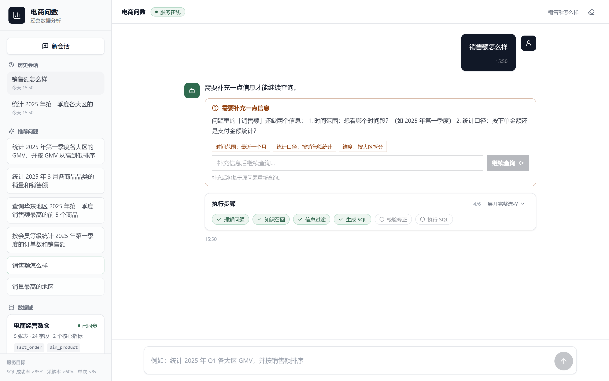

# 问数系统 · 电商自然语言问数（NL2SQL）

**中文提问 → SQL → 可验证的数据答案。** 业务人员直接问"华北地区上个月卖了多少钱"，秒级拿到真实数据，不用再排队等数据分析师取数。

实现方式：把数据库的表、字段、指标口径整理成可检索的元数据知识库，AI 基于知识库生成 SQL 并执行。

**我的角色**：0→1 产品经理，负责 PRD（V1→V6 六轮迭代）、AI 行为合同、评测标准、成本测算与灰度方案。

## 用一次是什么体验

- 用中文提问，SQL 执行出错自动纠错重试，对用户无感
- 结果卡不只给数字：SQL、命中字段、置信度全部展开，数据怎么来的可当场查证
- 问题模糊会追问补口径，查不到会明确说不支持——不会硬凑一个看起来对的答案
- 每一步检索、生成、校验可展开观察，链路透明

## 产品设计上我定了几件关键的事

**1. AI 只许说三种话：回答、追问、拒答**
模糊问题不硬猜，追问用户补口径；查不到的数据明确说不支持。写进 Prompt 行为合同——错答比报错危险，报错会重问，错答会让业务拿着假数据做决策。

**2. 每个环节标明「用 AI 还是用系统、为什么」**
12 节点流程里只有语义理解类环节（过滤、生成、纠错）调 LLM，关键词提取、校验、执行走系统——单次请求 LLM 调用上限 7 次由流程结构保证，单次查询成本压到 ¥0.0024。

**3. 上线由评测集说了算**
100 条三层评测集（60 场景 + 30 边界 + 10 回归）做上线门禁；越权查询和数据修改是一票否决项，出现 1 次直接回滚。

**4. 指标线必须说得出依据**
六条指标线分三种来源：有实测的按实测打折、没实测的标注"待校准"、一票否决类不打折。查询时长实测 P95 8.70s 已超 8s 目标线，处置是补并发和缓存——不是把线改成 9s。

## 实测结果

| 指标 | 结果 |
|---|---|
| SQL 结果准确率 | **98%**（L1 场景集 59/60） |
| SQL 执行成功率 | 98.6%（71 条 select 中 70 条成功） |
| 越权查询 / 数据修改 | **0 / 0** |
| 单次查询成本 | **¥0.0024**（328 条流水实测，月度约 ¥36~71） |
| 查询时长 P95 | 8.70s（超线，已列入优化项） |

---

指标定线依据、判分细则、敏感字段拦截、灰度与回滚等详细设计见 **[问数系统-PRD.pdf](./问数系统-PRD.pdf)**。

| 深入阅读 | 内容 |
|---|---|
| [shopkeeper-agent/](./shopkeeper-agent/) | 源码：LangGraph 12 节点编排 + SQL 安全白名单 + 成本/日志/badcase 模块 |
| [dify/](./dify/) | 元数据知识库三库（表字段/指标/真实取值）与构建脚本 |
| [原型截图/](./原型截图/) | 点踩归因、流程展开、降级提示等全部交互截图 |

> 技术栈：Python + FastAPI + LangGraph ｜ MySQL + Qdrant + Elasticsearch（IK）+ bge-large-zh ｜ React + Vite
